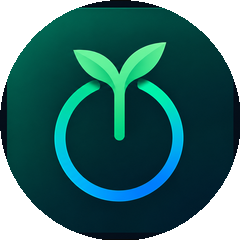
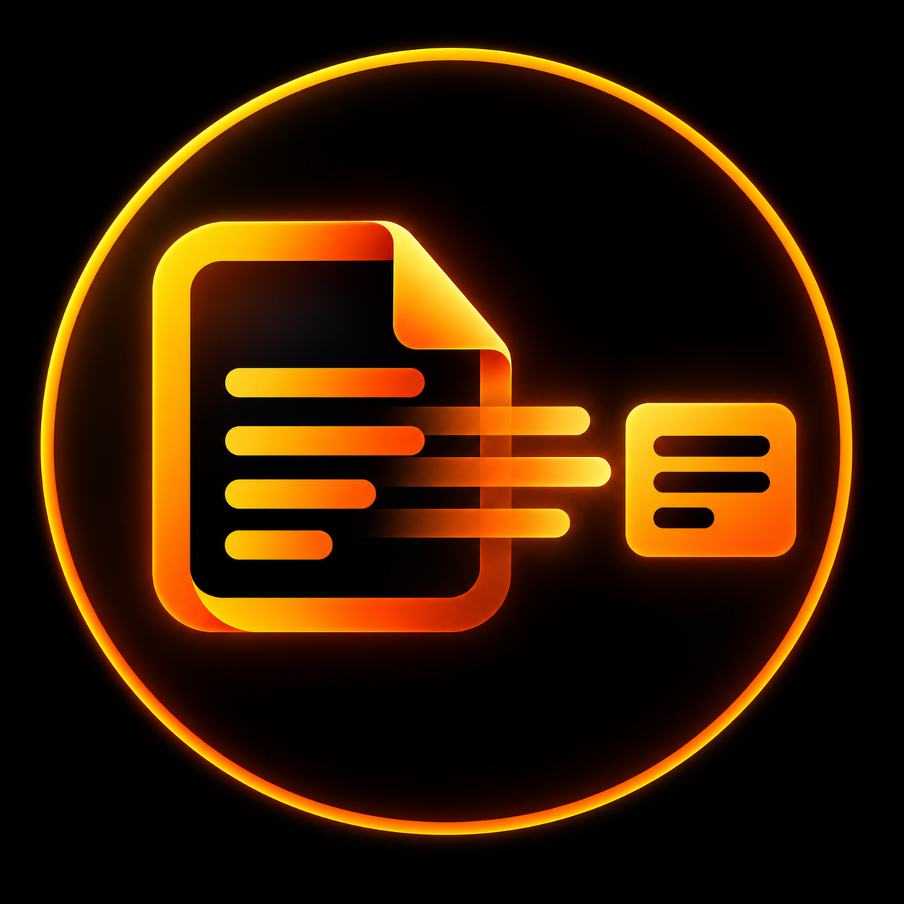
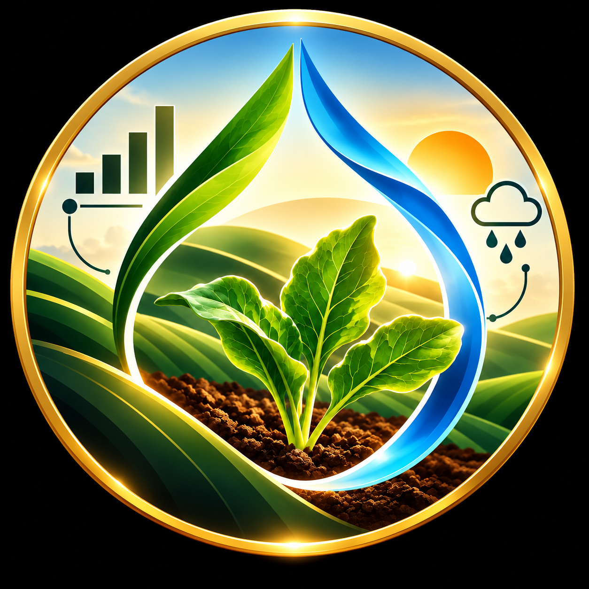
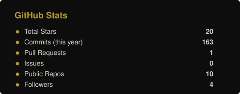

# Nihar Ranjan Patra

  

  

  

  
  
  
  

  
  

---

## About Me

Computer Science (Data Science) student at C.V. Raman Global University, graduating in 2027, with hands-on experience building end-to-end applications spanning frontend development, backend engineering, applied machine learning, and data analytics.

I enjoy developing practical solutions involving computer vision, document processing, LLM integration, and data engineering, with an emphasis on maintainable code and real-world applications.

- **CGPA:** 8.07
- **Focus:** Full-Stack Development, Applied AI, Data Science
- **Programming:** Python, SQL, R
- **Interests:** Backend Engineering, Computer Vision, Machine Learning, Data Analytics

## Technical Skills

  

  

  

  
  
  
  
  
  
  
  
  
  
  

**Core Concepts:** REST APIs, JWT Authentication, LLM Integration, Prompt Engineering, NLP, Computer Vision, OCR, Machine Learning, Data Structures and Algorithms, OOP, DBMS, Operating Systems, Computer Networks.

---

## Featured Projects

<table>
<tr>
<td width="50%" valign="top">

<h3>
  
  AgentForge
</h3>

**Autonomous AI Workflow Orchestration Platform**

An ongoing project exploring how specialized AI agents can collaborate to plan, execute, and monitor complex workflows.

- Designing a multi-agent architecture with Planner, Researcher, Analyst, and Reviewer agents.
- Established the backend API and frontend dashboard foundations.
- Designed database models for workflows, executions, approval requests, and audit events.
- Implemented database migrations and automated tests.
- Building towards controlled tool execution, human approvals, and workflow monitoring.

**Stack:** Python, FastAPI, React, TypeScript, PostgreSQL, SQLAlchemy, Alembic, Pydantic.

  <a href="https://github.com/Niharxd/Agent-Forage">Source Code</a> ·
  

</td>
<td width="50%" valign="top">

<h3>
  
  Heritage AI
</h3>

**Computer Vision and Applied AI for Cultural Heritage Preservation**

A full-stack application for visual assessment and documentation of cultural heritage structures.

- Built a six-stage image analysis pipeline covering detection, enhancement, prediction, and explainability.
- Implemented OpenCV-based damage detection for cracks, stains, erosion, and fading, with per-image severity scoring.
- Integrated multilingual OCR and explainable risk prediction.
- Developed the analysis dashboard, archive, comparison tools, and export functionality.

**Stack:** Python, FastAPI, React, TypeScript, OpenCV, PyTorch, OCR.

  <a href="https://heritage-ai-niharxds-projects.vercel.app/">Live Demo</a> ·
  <a href="https://github.com/Niharxd/HeritageAI">Source Code</a>

</td>
</tr>

<tr>
<td width="50%" valign="top">

<h3>
  
  GHG Platform
</h3>

**Cloud Carbon Accounting and Emissions Intelligence**

A full-stack platform for greenhouse gas emissions tracking, analytics, and machine learning-based prediction.

- Built emissions tracking with JWT authentication and PDF report generation.
- Developed a Linear Regression vs. Random Forest pipeline with automatic model selection, achieving 99.7% test accuracy in the evaluated prediction workflow.
- Engineered CPU, RAM, storage, and regional carbon-intensity features across six regions.
- Implemented anomaly detection, efficiency scoring, and sustainability scoring.

**Stack:** Python, FastAPI, React, TypeScript, MySQL, Scikit-learn.

  <a href="https://carbon-accounting-two.vercel.app/">Live Demo</a> ·
  <a href="https://github.com/Niharxd/Carbon-Accounting">Source Code</a>

</td>
<td width="50%" valign="top">

<h3>
  
  Document Summarizer
</h3>

**AI-Powered Document Processing and Summarization**

A document processing application that extracts and preprocesses text before generating summaries using an LLM API.

- Built document extraction and preprocessing for multiple document formats.
- Integrated Cohere API for LLM-based summarization.
- Developed a document-processing ETL pipeline with Python and PySpark components.
- Prepared document data for context-aware summarization.

**Stack:** Python, PySpark, Cohere API, NLP, ETL.

  <a href="https://document-summarizer-9vwi.onrender.com/">Live Demo</a> ·
  <a href="https://github.com/Niharxd/Document-Summarizer">Source Code</a>

The demo runs on free hosting, so the first load may take around 30 seconds.

</td>
</tr>

<tr>
<td width="50%" valign="top">

<h3>
  
  Pixels to Water
</h3>

**Crop Classification, LAI Estimation and Irrigation Decision Support**

A research project exploring crop image analysis and environmental data for crop monitoring and irrigation decision support.

- Classifies 100 sorghum cultivars using image models.
- EfficientNet-B0 achieved 74.2% test accuracy on the evaluated split.
- Compares Random Forest and CNN-based lettuce LAI estimation.
- Combines estimated LAI, ET₀, growing environment, and rainfall in rule-based demand classification.

**Stack:** Python, PyTorch, Scikit-learn, Pandas, NumPy, Jupyter.

  <a href="https://github.com/Niharxd/pixels-to-water">Source Code</a>

Research prototype. Irrigation rules have not been validated against field outcomes.

</td>
<td width="50%" valign="top">

</td>
</tr>
</table>

---

## Experience

### Bluestock Fintech
**Data Analyst Intern · Remote** | May 2026 – July 2026

- Built a Mutual Fund Analytics Platform using a Python ETL pipeline with Pandas, SQLAlchemy, and SQLite.
- Processed 46,000+ NAV records and 32,000+ investor transactions across 40 AMFI schemes.
- Computed financial risk and performance metrics including Sharpe Ratio, Sortino Ratio, Alpha, Beta, Value at Risk, and Maximum Drawdown.
- Presented analytical findings through a four-page Power BI dashboard.

### Amdox Technologies
**Data Analyst Intern** | January 2026

- Analyzed historical price data across multiple cryptocurrencies.
- Identified volatility patterns, short-term trends, and anomalies.
- Presented findings through data analysis and visualizations.

### Cognifyz Technologies
**Data Analyst Intern · Remote** | December 2025

- Performed exploratory data analysis on a real-world restaurant dataset using Pandas and Matplotlib.
- Identified trends across ratings, cuisine types, and geographical distributions.
- Summarized analytical findings in a report for the team.

---

## Certifications

| Certification | Issuer | Date |
|---|---|---|
| Generative AI Leader Track | Google Cloud Career Launchpad | Apr 2026 |
| Introduction to Greenhouse Gas Accounting for IT | Cisco Networking Academy | Apr 2026 |
| 5-Day AI Agents Intensive Course with Google | Kaggle | Dec 2025 |
| User Experience (UX) Design | Coursera | Nov 2025 |
| Data Analytics Essentials | Cisco Networking Academy | Jul 2025 |
| Quantium Data Analytics Job Simulation | Forage | Jun 2025 |

---

## Education

**C.V. Raman Global University**

B.Tech in Computer Science (Data Science)  
Expected Graduation: 2027  
**CGPA:** 8.07

**Kendriya Vidyalaya**

- Class XII – PCM | 71.5% | 2023
- Class X | 90.3% | 2021

---

## Coding Profiles

  <a href="https://leetcode.com/u/Nihar_Patra/">LeetCode</a> ·
  <a href="https://github.com/Niharxd">GitHub</a>

---

## GitHub Analytics

  
  

  

  

---

## Current Focus

  

- Developing AgentForge and exploring multi-agent workflow orchestration.
- Strengthening Data Structures and Algorithms.
- Building reliable backend services and full-stack applications.
- Exploring applied AI, LLM integration, computer vision, and NLP.
- Improving data engineering, analytics, and database optimization.
- Building projects with clean architecture, testing, and maintainable code.

---

  

  Building practical solutions through code, data, and continuous learning.

  
  
  
  

  

