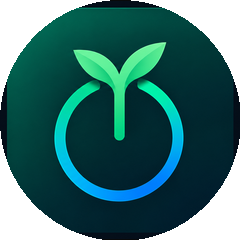
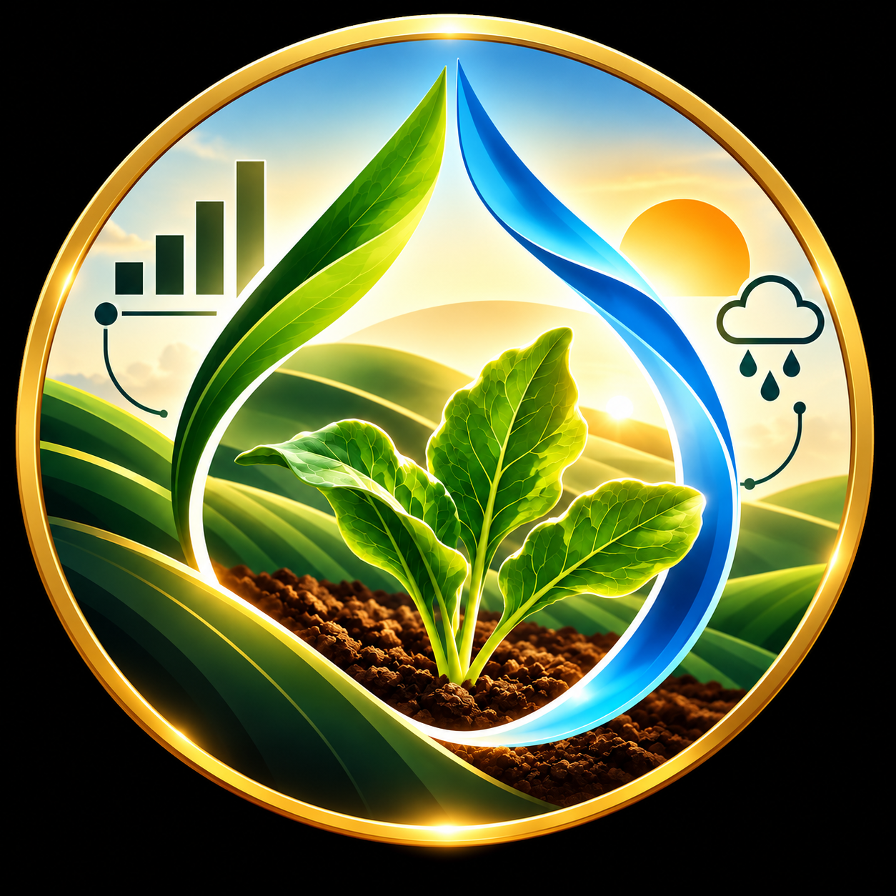

# Nihar Ranjan Patra

  

  <a href="https://portfolio-nihar-patra.vercel.app/">Portfolio</a> ·
  <a href="https://linkedin.com/in/nihar-patra-2277np">LinkedIn</a> ·
  <a href="mailto:niharpatra2277@gmail.com">Email</a> ·
  <a href="https://github.com/Niharxd">GitHub</a>

  
  

---

## About Me

Final-year B.Tech student in Computer Science and Engineering (Data Science) at C.V. Raman Global University, graduating in 2027.

I build practical applications across full-stack development, data analytics, machine learning, and computer vision, with an emphasis on useful features, maintainable code, and real-world applications.

- **CGPA:** 8.07
- **Focus:** Software Development, Data Science, Applied AI
- **Languages:** Python, Java, JavaScript, SQL
- **Interests:** Backend Engineering, Machine Learning, Data Analytics

## Technology

  

  

  

  
  
  
  
  
  
  
  

---

## Featured Projects

<table>
<tr>
<td width="50%" valign="top">

<h3>
  
  Heritage AI
</h3>

**AI-Assisted Cultural Heritage Preservation**

A full-stack application for preliminary visual assessment and documentation of cultural heritage structures.

- Image processing and damage indicators using OpenCV.
- Visualizations and rule-based risk assessment.
- Multilingual OCR and saved assessment records.
- Decision support, not professional structural diagnosis.

**Stack:** Python, FastAPI, React, TypeScript, OpenCV, PyTorch.

  <a href="https://heritage-ai-niharxds-projects.vercel.app/">Live Demo</a> ·
  <a href="https://github.com/Niharxd/HeritageAI">Source Code</a>

</td>
<td width="50%" valign="top">

<h3>
  
  GHG Platform
</h3>

**Carbon Accounting and Emissions Analytics**

A full-stack platform for greenhouse gas emissions tracking, analysis, and machine learning-based prediction.

- Emissions data management and analysis.
- JWT-based authentication.
- Linear Regression and Random Forest comparison.
- Reports 99.7% test accuracy in the evaluated prediction workflow.

**Stack:** Python, FastAPI, React, TypeScript, MySQL, Scikit-learn.

  <a href="https://carbon-accounting-two.vercel.app/">Live Demo</a> ·
  <a href="https://github.com/Niharxd/Carbon-Accounting">Source Code</a>

</td>
</tr>
<tr>
<td width="50%" valign="top">

<h3>
  
  Document Summarizer
</h3>

**Domain-Aware AI Document Summarization**

A document processing system that classifies documents into legal, medical, or technical domains and generates context-specific summaries.

- Extracts text from PDF, DOCX, and TXT files.
- Uses Cohere API with domain-specific prompts.
- PySpark ETL for cleaning, entity extraction, and quality metrics.
- Gradio interface and Grafana metrics dashboards.

**Stack:** Python 3.13, PySpark, Cohere API, Gradio, Grafana.

  <a href="https://document-summarizer-9vwi.onrender.com/"><strong>Live Demo</strong></a> ·
  <a href="https://github.com/Niharxd/Document-Summarizer">Source Code</a>

</td>
<td width="50%" valign="top">

<h3>
  
  Pixels to Water
</h3>

**Crop Classification, LAI Estimation and Irrigation Decision Support**

A research project exploring crop image analysis and environmental data for crop monitoring and irrigation decision support.

- Classifies 100 sorghum cultivars using image models.
- EfficientNet-B0 achieved 74.2% test accuracy on the evaluated split.
- Compares Random Forest and CNN-based lettuce LAI estimation.
- Combines estimated LAI, ET₀, growing environment, and rainfall in rule-based demand classification.

**Stack:** Python, PyTorch, Scikit-learn, Pandas, NumPy, Jupyter.

  <a href="https://github.com/Niharxd/pixels-to-water">Source Code</a>

Research prototype. Irrigation rules have not been validated against field outcomes.

</td>
</tr>
</table>

---

## Experience

### Bluestock Fintech
**Data Analytics Intern** · May 2026 – July 2026

- Built data processing workflows using Python, Pandas, SQLAlchemy, and SQLite.
- Processed more than 46,000 NAV records and 32,000 investor transactions across 40 AMFI schemes.
- Analyzed Sharpe Ratio, Sortino Ratio, Alpha, Beta, Value at Risk, and Maximum Drawdown.
- Developed Power BI dashboards and a financial intelligence workflow for Nifty 100 company analysis.

### Amdox Technologies
**Data Analytics Intern** · January 2026

- Performed exploratory data analysis on cryptocurrency data.
- Used Python-based data processing and visualization to explore patterns and trends.

### Cognifyz Technologies
**Data Analytics Intern** · December 2025

- Performed exploratory data analysis on restaurant data.
- Used Python and visualization techniques to investigate ratings and dataset characteristics.

---

## Certifications

| Certification | Issuer | Date |
|---|---|---|
| Generative AI Leader Track | Google Cloud Career Launchpad | Apr 2026 |
| Introduction to Greenhouse Gas Accounting for IT | Cisco Networking Academy | Apr 2026 |
| 5-Day AI Agents Intensive Course | Kaggle | Dec 2025 |
| User Experience (UX) Design | Coursera | Nov 2025 |
| Data Analytics Essentials | Cisco Networking Academy | Jul 2025 |
| Quantium Data Analytics Virtual Experience | Forage | Jun 2025 |

---

## Education

**C.V. Raman Global University**

B.Tech in Computer Science and Engineering (Data Science)  
Expected Graduation: 2027  
**CGPA:** 8.07

---

## Coding Profiles

  <a href="https://leetcode.com/u/Nihar_Patra/">LeetCode</a> ·
  <a href="https://www.geeksforgeeks.org/user/niharpatgy27/">GeeksforGeeks</a> ·
  <a href="https://github.com/Niharxd">GitHub</a>

---

## GitHub Analytics

  
  

  

---

## Current Focus

- Strengthening Data Structures and Algorithms.
- Building practical full-stack applications with Python and React.
- Improving machine learning, computer vision, and data analytics skills.
- Learning system design, backend engineering, and database optimization.
- Developing projects with clear documentation and maintainable code.

---

  

  Building practical solutions through code, data, and continuous learning.

  <a href="https://portfolio-nihar-patra.vercel.app/">Portfolio</a> ·
  <a href="https://linkedin.com/in/nihar-patra-2277np">LinkedIn</a> ·
  <a href="mailto:niharpatra2277@gmail.com">Email</a>

